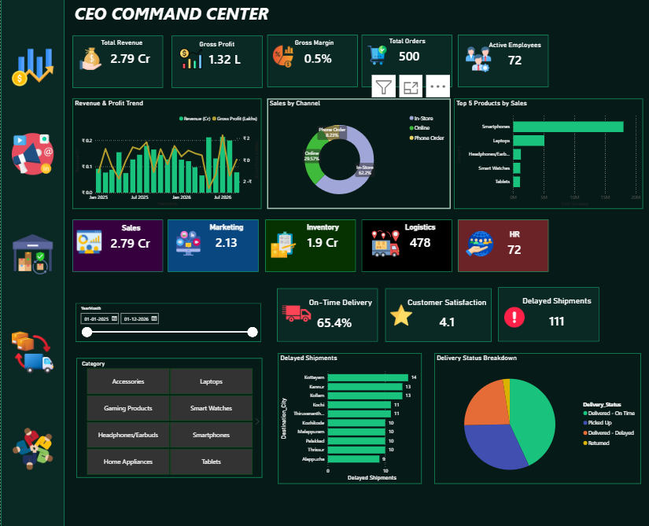

# Hi, I'm Romy Avril Augustine 👋

**Data Analyst - Power BI, SQL, Python, Tableau - Transforming Raw Data to Real Insights**

[LinkedIn](https://www.linkedin.com/in/romyavril/)

## 👩‍💻 About Me

I am a data enthusiast passionate about uncovering insights, solving problems, and transforming complex datasets into meaningful business intelligence.

Bringing over 9 years of professional experience in Operations, Finance, and Accounts Management, I combine practical business knowledge with analytical thinking to turn data into meaningful insights and smarter decisions.

With hands-on experience in Python, SQL, Excel, and Power BI, I enjoy working across the data analytics lifecycle — from data extraction and cleaning to analysis, visualization, and storytelling.

I believe data is more than just numbers; it's an opportunity to discover patterns, solve real-world problems, and drive informed business decisions.

I am continuously learning, exploring new technologies, and building practical projects that bridge the gap between raw data and real-world impact

**My goal: Turn data into clarity, insights into action, and challenges into opportunities**

## 🎓 Education  
- **BCA - Bachelors of Computer Applications**  
  *St. Joseph's College, Bangalore, Karnataka (2013 – 2016)*

- **Data Analytics course**  
  *Rows & Columns, Kochi*

## 💼 Professional Experience

### Freelance Data Analytics

**Michael & Co. Event Planners**
- Developed interactive Excel dashboards to track key business metrics.
- Automated reports to improve business performance monitoring.

**Cordial Bar**
- Built monthly Power BI reports to track key business metrics.
- Automated manual reporting processes to streamline operations.
- Improved data accessibility for better operational tracking.

**Carmel Marine Engineering Works**
- Developed weekly and monthly Power BI reports based on business requirements.
- Presented business insights to support performance monitoring and decision-making.
  
---

### Account / Finance Manager · 2025 – 2026
**Carmel Marine Engineering Works, Kochi, India**
- Managed invoices, quotations, payments, and cash flow.
- Maintained vendor payment records and project financial documentation.
- Supported budgeting, cost tracking, and financial analysis.
- Conducted financial checks and reconciliations to ensure data accuracy.

---

### Senior Process Associate & Finance Processor · 2017 – 2024
**Biipbyte Technologies Pvt. Ltd., Bangalore, India**
- Coordinated with Singapore headquarters on audit projects and confidential assignments, maintaining 100% compliance.
- Prepared weekly and monthly operational and financial reports for international stakeholders.
- Managed invoice processing, payment tracking, reconciliations, and data audits.
- Developed SOPs, monitored SLA/KPI performance, and supported process improvement and team management.

  ## 🧠 Tools & Skills  
 
 
 
 
  

---

## 🎯 Interests  
- 📊 Dashboard Design  
- 📸 Photography & Video Editing
- 🎬 Movies & 🎒 Traveling  

---

## 📫 Contact Details  
*Let’s connect and see how we can make a difference together!*  

<table>
  <tbody>
    <tr>
      <td>📧</td>
      <td><a href="mailto:avrilaugustine1996@gmailcom">avrilaugustine1996@gmail.com</a></td>
    </tr>
    <tr>
      <td>📞</td>
      <td>(+91) 901-941-9205</td>
    </tr>
    <tr>
      <td>📍</td>
      <td>Kochi, Kerala, India</td>
    </tr>
    <tr>
      <td>⬇️</td>
      <td><a href="">Download my CV</a></td>
    </tr>
    <tr>
      <td>🌐</td>
      <td><a href="https://www.linkedin.com/in/romyavril/">Let’s connect on LinkedIn</a></td>
    </tr>
  </tbody>
</table>

  

